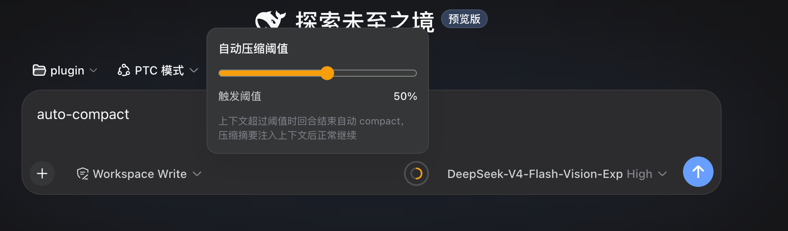

# dsh-auto-compact

[中文](./README.md) · **English**

**A session-level automatic context-compaction plugin for DeepSeek Harness (DSH).**



**dsh-auto-compact** displays a threshold ring and real-time context usage beside the input. Sessions without a manual override follow the current model's explicit maximum Context in the profile: below 300K defaults to 80%, above 800K to 30%, and all other or unknown capacities to 50%. The three defaults are editable as integer percentages from 1 through 99 in the plugin configuration page. Dragging the slider sets a session override (10%–90%, 5% steps); Restore default removes it. Compaction runs when usage exceeds the effective threshold, checked before each step and at turn end. The compacted summary is injected so the session continues naturally, without an extra "continue" message.

## Features

- 🔴 **Session overrides** — independent and persistent; model changes preserve manual values, Restore default resumes automatic tracking
- 📊 **Real-time usage** — same source as the built-in ContextMeter (`useProjection("contextPressure")`), updated by projections
- 🎚️ **10%–90% slider** — 5% steps; configured 23% and historical manual 37% display unchanged until a user drag selects a step
- ⚙️ **Model-aware defaults** — three live configuration fields with Save, Discard and per-field Reset
- 🎨 **Theme-aware panel** — fully opaque background in light and dark themes; outside clicks close it while still activating underlying controls, inside whitespace stays open
- 🤖 **Fully automatic** — checked before each step in a turn and at turn end → auto-compacts over threshold → summary injected and the turn continues naturally
- 🛡️ **Crash-safe** — all checks run inside `agent/pre-step` (waterfall middleware) and `agent/turn-stopping` (serial event), fully wrapped in try/catch, never throwing
- 💾 **Persistent** — thresholds live in the plugin's own JSON file (`$DSH_HOME/dsh-auto-compact.json`, default `~/.dsh/dsh-auto-compact.json`), surviving restarts
- 🧊 **Coexists with the built-in safety net** — DSH's own `compaction-basic` (default 80% pressure threshold) remains as a fallback, without interference

## Installation

**Prerequisites**: DSH ≥ 0.2.0-rc.2 and < 0.3 — the live configuration forms and selection interfaces used here were verified against real components from both 0.2.0-rc.2 and 0.2.1-alpha.2. Node.js ≥ 20 for the plugin. Development tests use jsdom 30 and need Node.js ≥ 24; this change was verified on Node 24.21.

> **Upgrading from the old `auto-compact`**: the old package was named `auto-compact`, the new one is `dsh-auto-compact`. Uninstall the old package first to avoid double-mounting (two Host halves, two rings):
> ```bash
> npx -y --package @deepseek-ai/dsh dsh plugin --profile web remove auto-compact
> ```

### One-shot install (recommended, copy & paste)

**macOS / Linux** (Windows via Git Bash or WSL works too):

```bash
curl -fsSL https://raw.githubusercontent.com/Huangsir/dsh-auto-compact/master/scripts/install.sh | bash
```

The script handles everything: install npm dependencies → register the official mount (`dsh.profile.bundles`) → clean up leftover mount lines from old versions. All you need to do:

1. Run that single command
2. **Restart DSH** (the script prints the command when done; you can also add `--restart` to auto-restart: `curl ... | bash -s --restart`)
3. Hard-refresh the browser (macOS `Cmd+Shift+R` / Windows·Linux `Ctrl+Shift+R`) — the threshold ring appears to the right of the input area ✅

> The script handles this automatically: `dsh` is usually not on the global PATH (DSH is typically installed via npx, so typing `dsh` directly gives command not found); the script falls back to invoking it via npx, no user action needed.

### Or

```bash
npx -y --package @deepseek-ai/dsh dsh plugin --profile web add dsh-auto-compact
```

After installing you still need to restart DSH and hard-refresh the browser.

### Install from a local checkout (no npm release)

`dsh-auto-compact` is not published to npm yet, so the `dsh plugin --profile web add dsh-auto-compact` command above needs a reachable registry. To run your own checkout, link it into the profile instead:

```bash
git clone https://github.com/Huangsir/dsh-auto-compact.git
cd dsh-auto-compact
npx -y --package @deepseek-ai/dsh dsh plugin --profile web add "$PWD"
```

pnpm registers the profile dependency as `link:`, so editing the code takes effect after a DSH restart with no reinstall; the package's `dsh.bundle.patch` layer is still reconciled into `dsh.profile.bundles`.

### Update / Uninstall

- **Update**: re-run the one-shot install command (or the manual command), then restart DSH and hard-refresh the browser
- **Uninstall**: `npx -y --package @deepseek-ai/dsh dsh plugin --profile web remove dsh-auto-compact`, then restart to take effect; if you manually wrote a mount line in `cordis.patch.yml`, remove it too to avoid double-mounting (two Host halves, two rings)

## Usage

1. On the host plugin configuration page, edit “模型最大 Context 小于 300K”, “模型最大 Context 大于 800K” and “其余情况” (maximum Context below 300K, above 800K, and all other cases). Values must be integer percentages from 1 through 99. Save commits, Discard drops drafts, and Reset clears a field override after Save.
2. Open the input-side ring to see the effective threshold and live usage. Capacities exactly equal to 300K or 800K belong to the other tier.
3. Drag the slider to save a session override, using 10%–90% in 5% steps. Existing non-step values are displayed unchanged; the thumb sits near a step without rewriting the stored ratio.
4. Click “恢复默认” (Restore default) to remove the session override. It immediately uses the current model default and follows later model/configuration changes.
5. Outside clicks close the panel and still activate underlying controls. Clicking inside whitespace keeps it open. Failed saves show an error and preserve the accepted threshold.
6. Model changes, configuration saves and Restore default only update thresholds. Compaction is still considered at the next pre-step or turn-stopping check.

## How it works

- **Host half** (`lib/index.js`): listens for `agent/pre-step` (before each step in a turn, waterfall middleware) and `agent/turn-stopping` (turn end, serial event), reads the current session threshold and usage (`tokenMeter.measure()` / `contextPressure` projection), and when over threshold calls `agentPresets.serviceFor(agent, 'compaction').compactIfNeeded(agent, 'context-overflow', signal)` to compact — taking the context-overflow path, bypassing the engine's own 0.8 threshold check, fully controlled by the slider.
- **Client half** (`lib/client.js`): registers the ring in `conversation.input.right` and a host form in `plugins.bundle.config`. `/dsh-auto-compact/api/thresholds.resolve` reads the authoritative effective threshold, `thresholds.set` saves an override, and `thresholds.reset` removes it. Legacy `thresholds.get/set` still read/write the manual table.
- **Cold sessions**: a persisted session that is not active yet — the ring must render before the session is activated — resolves through the host read-only session query `sessionQuery.observeSession` without pulling the session into memory; an unavailable query or an unknown session is still rejected, and the client never supplies model capacity. Cordis exposes only `inject`-declared services as context properties: an undeclared name throws `cannot get property ... without inject`, so `ctx.sessionQuery ?? ctx.get(...)` never reaches its fallback and the cold path could only answer 400 (the reported symptom: after a restart the ring sits at its zero-length "loading" arc until the session or model is switched). The host now binds the service the way DSH binds its own optional services, through a child fiber — `ctx.inject(['sessionQuery'], child => …)` — which stays pending while the service is absent so the plugin still loads, then hands over the implementation; `ctx.get('sessionQuery', false)` is the fallback for hosts without `ctx.inject`.
- **Client retry**: a failed first read retries with bounded backoff (400ms → 1s → 2.5s → 5s → 10s; switching session or model cancels a stale retry), so the ring recovers on its own once the host activates the session or the service becomes ready.
- **Model capacity**: selection comes from `modelSelection.next`, then the latest request header; fresh sessions use the current host default. The plugin reads `$DSH_PROFILE_DIR/cordis.patch.yml`, or `$DSH_HOME/profiles/$DSH_PROFILE/cordis.patch.yml` when the directory variable is absent (home defaults to `~/.dsh`). GUI host processes export neither variable, so in that case the **sole** profile whose `package.json` declares this plugin's dependency locates the file; several or none fall back to the other tier. It matches provider and the full model id exactly, retaining slashes. Only explicit positive safe-integer `contextWindow` values select a tier. Unreadable files, unmatched models, ambiguous patches and invalid capacities use the other tier. `!!js` expressions are never evaluated. Built-in directories and recent request pressure capacities do not determine defaults.
- **Persistence**: the JSON `thresholds` table contains explicit session overrides only. New values publish after a successful durable write; configuration commits use the host's revision form. Usage and its denominator continue to use `tokenMeter` / `contextPressure`, independently of the capacity used for default tiers.

## Verification

```bash
npm test
npm run check:compat -- --dsh /path/to/dsh --runtime 0.2.0-rc.2 --runtime 0.2.1-alpha.2
node --check lib/index.js
node --check lib/client.js
npm pack --dry-run
```

The compatibility gate invokes DSH's own `evaluatePluginCompatibility`. New configuration/selection peers require the verified floor `>=0.2.0-rc.2 <0.3.0-0`, exercised against real components from both 0.2.0-rc.2 and 0.2.1-alpha.2; the `-0` upper bound also rejects 0.3 prereleases.

## Dependencies

- Requires DSH's `compaction-basic` (`@deepseek-ai/dsh-compaction-basic`) to be enabled — included in the default presets (standard / code / cordis), except the `minimal` preset
- All peer dependencies ship with DSH; nothing extra to install

## License

MIT
