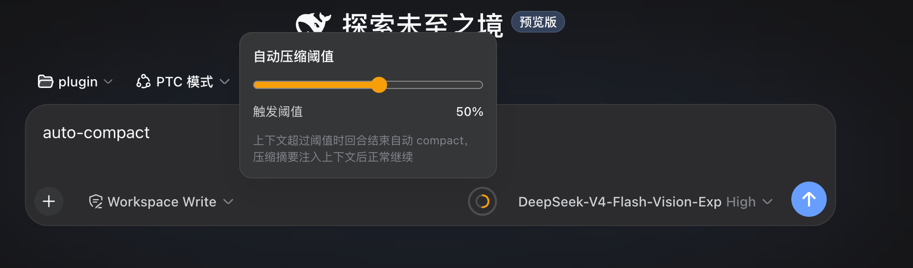
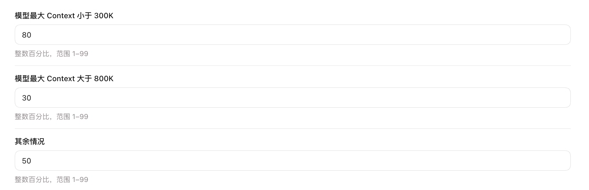

# dsh-auto-compact

**English** · [中文](./README.zh.md)

Session-level automatic context compaction for DeepSeek Harness (DSH).



## What it does

- **Threshold ring** — sits to the right of the input. The arc shows the effective threshold; click it for live context usage.
- **Compacts on its own** — usage is checked before every step of a turn and again when the turn ends. Once it crosses the threshold, the plugin compacts and the summary is injected, so the turn keeps going without an extra "continue" message.
- **Model-aware defaults** — a model whose configured max Context is below 300K compacts at 80%, above 800K at 30%, everything else (including unknown capacities) at 50%. Each default is editable from 1 to 99%.
- **Per-session override** — a 10%–90% slider in 5% steps pins the threshold for the current session. It survives model switches and restarts; "恢复默认" (Restore default) drops it and follows the model again.
- **Stored on disk** — overrides live in `$DSH_HOME/dsh-auto-compact.json` (default `~/.dsh/dsh-auto-compact.json`), so nothing is lost on restart.
- **Never breaks a turn** — all checks run inside `agent/pre-step` and `agent/turn-stopping`, wrapped in `try/catch`.
- **No fight with the built-in** — DSH's own `compaction-basic` (80% pressure) stays enabled as a safety net.

## Settings



Three fields set the defaults: 「模型最大 Context 小于 300K」 (below 300K), 「模型最大 Context 大于 800K」 (above 800K) and 「其余情况」 (everything else). Values are integer percentages from 1 to 99. Save commits, Discard drops the draft, Reset clears a field's override.

## Install

Requires DSH ≥ 0.2.0-rc.2 (and < 0.3) and Node.js ≥ 20.

```bash
dsh plugin --profile web add "github:Huangsir/dsh-auto-compact"
```

The command installs the package from GitHub and mounts it in the profile. Restart DSH and hard-refresh the browser — the ring appears next to the input.

> The `dsh-auto-compact` package on npm (latest 0.1.2) is an older, unrelated build. Install from this repository to get this code.

## Use

Click the ring to open the panel: drag the slider to set a session override, or press 「恢复默认」 to drop it. A threshold change only takes effect at the next pre-step or turn-end check.

## License

MIT
