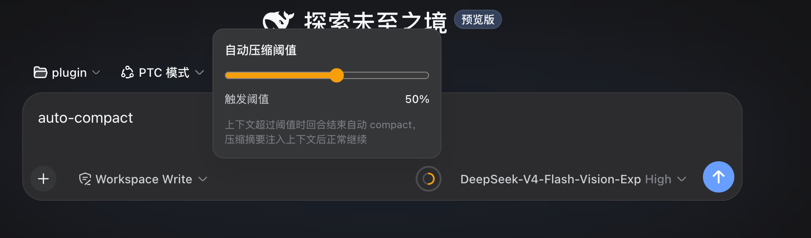
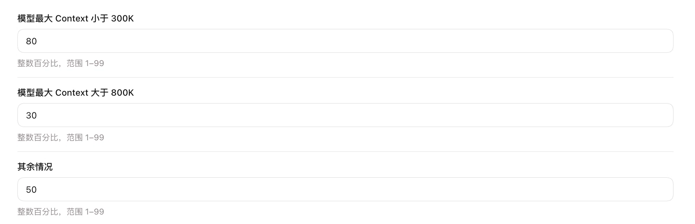

# dsh-auto-compact

[English](./README.md) · **中文**

会话级自动上下文压缩插件（DeepSeek Harness / DSH）



## 功能

- **阈值圆环**：在输入区右侧，圆环弧长就是当前有效阈值，点开可以看到实时上下文用量。
- **自动压缩**：回合中每步之前和回合结束时各检查一次用量，超过阈值就执行 compact；摘要注入后回合自然继续，不会额外发一条「继续」消息。
- **按模型分档的默认阈值**：模型的最大 Context 小于 300K 按 80%，大于 800K 按 30%，其余（含未知容量）按 50%；三个值都能改成 1–99。
- **会话级手动阈值**：滑杆 10%–90%、步进 5%，只作用于当前会话；切模型、重启都保留，点「恢复默认」后重新跟随模型。
- **落盘持久化**：手动值存在 `$DSH_HOME/dsh-auto-compact.json`（默认 `~/.dsh/dsh-auto-compact.json`）。
- **不打断回合**：所有检查都在 `agent/pre-step` 和 `agent/turn-stopping` 里，外层包了 try/catch。
- **与内置机制并存**：DSH 自带的 `compaction-basic`（80% 压力阈值）继续作为兜底。

## 配置



三个字段设定默认阈值：「模型最大 Context 小于 300K」「模型最大 Context 大于 800K」「其余情况」，取值为 1–99 的整数百分比。Save 保存，Discard 放弃草稿，Reset 清除单个字段的修改。

## 安装

需要 DSH ≥ 0.2.0-rc.2 且 < 0.3，Node.js ≥ 20。

```bash
dsh plugin --profile web add "github:Huangsir/dsh-auto-compact"
```

这条命令直接从 GitHub 安装并挂载到 profile。装完重启 DSH 并强刷浏览器，输入区右侧会出现阈值圆环。

> npm 上的 `dsh-auto-compact`（最新 0.1.2）是另一个更早的版本，和本仓库不是同一份代码，要装这份请从 GitHub 安装。

## 使用

点圆环打开面板：拖滑杆设置当前会话的手动阈值，点「恢复默认」清除。阈值改动要等下一次每步前或回合结束的检查才会触发压缩。

## 许可证

MIT
